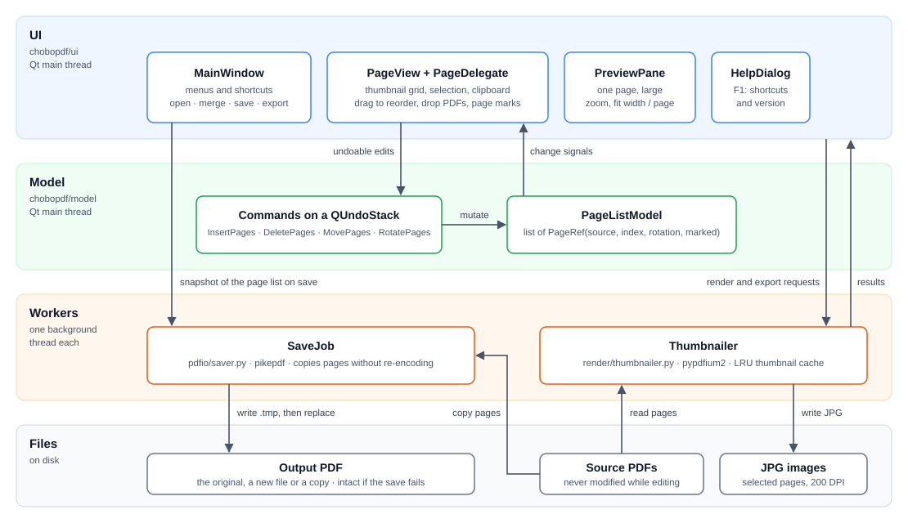

# ChoboPDF

[English](README.md) | 한국어

수백 MB짜리 대용량 PDF의 페이지를 썸네일로 보면서 옮기고, 돌리고, 지우고, 합치고, 추출하는 Windows 데스크톱 툴입니다.

페이지 정리 한 가지 일만 하며, 세 가지를 기준으로 만들었습니다.

- **큰 파일에서도 빠릅니다.** 편집 중에는 메모리의 페이지 목록만 바뀌고 PDF는 저장할 때 한 번만 씁니다. 500MB 스캔 문서에서도 이동·회전·삭제가 바로 반영됩니다.
- **화질이 그대로입니다.** 페이지 내용을 재압축 없이 그대로 복사해 저장합니다.
- **안전하고 오프라인입니다.** 모든 편집은 실행 취소되고, 저장이 실패하거나 취소되어도 기존 파일은 그대로 남으며, 파일을 어디에도 올리지 않습니다.

## 0.1.2에서 달라진 점

- **Tab으로 포커스 이동**: `Tab`으로 썸네일과 미리보기 사이를 오갈 수 있어, 미리보기의 페이지 이동 키를 클릭 없이 쓸 수 있습니다.
- **포커스 표시**: 미리보기가 열려 있는 동안, 키보드 입력을 받는 쪽에 강조색 테두리가 표시됩니다.
- **어디서나 확대/축소, 맞춤 키**: `Ctrl++` / `Ctrl+-`(확대/축소), `Ctrl+0`(폭 맞춤), `Ctrl+9`(쪽 맞춤)는 포커스가 어디에 있든 동작합니다.
- **Enter로 미리보기 열기**: 썸네일에서 더블 클릭 대신 `Enter`를 눌러도 미리보기가 열립니다.

### 0.1.1

- **페이지 추출**: 선택한 페이지만 새 PDF로 저장합니다 (`Ctrl+E`).
- **암호 걸린 PDF**: 암호가 필요한 파일을 열 때 암호를 물어봅니다.
- **끝낼 때 저장**: 변경 내용이 있는 채로 끝내면 버릴지만 묻지 않고 저장, 다른 이름으로 저장도 고를 수 있습니다.
- **미리보기 화살표 키**: `←` / `→`로 이전 / 다음 페이지로 넘어갑니다.
- **버전 표시**: 제목 표시줄과 도움말에 버전을 `V0.1.1`로 표시합니다.

## 기능

### 열기와 합치기

- **여러 파일 병합**: 여러 PDF를 한 번에 열면 파일 이름순으로 이어 붙입니다. 숫자는 값으로 비교하므로 `2.pdf`가 `10.pdf`보다 앞에 옵니다.
- **PDF 추가**: 열려 있는 문서에 다른 PDF의 페이지를 끼워 넣습니다. 탐색기에서 썸네일 사이로 끌어다 놓으면 그 위치에 들어갑니다.
- **암호 걸린 PDF**: 열 때 암호를 물어보고, 틀리면 다시 묻습니다. 병합하거나 추가하는 파일에도 똑같이 동작합니다.

### 편집

- **페이지 편집**: 드래그로 순서 변경, 삭제, 좌우 90° 회전, 잘라내기/복사/붙여넣기, 복제. 여러 장을 선택해 한 번에 처리할 수 있고 모든 편집은 실행 취소됩니다.
- **페이지 표시**: 기준으로 삼을 페이지의 오른쪽 위에 책갈피 모양 표시를 달아 둘 수 있어, 다른 페이지를 옮기거나 지우는 동안 기준 페이지를 놓치지 않습니다. 표시는 페이지를 따라다니며 PDF에는 저장되지 않습니다.

### 보기

- **미리보기**: 페이지를 더블 클릭하거나 `Enter`를 누르면 창이 좌우로 나뉘고 오른쪽에 그 페이지를 크게 보여 줍니다. 25~400% 확대/축소, 폭 맞춤, 쪽 맞춤을 지원하고, 화살표 키로 페이지를 넘깁니다. `Tab`으로 썸네일과 미리보기 사이에서 포커스를 옮깁니다.
- **썸네일 확대**: 상태 표시줄의 슬라이더나 Ctrl+휠로 100~200%까지 키울 수 있습니다.

### 저장과 내보내기

- **안전한 저장**: 백그라운드에서 임시 파일에 쓴 뒤 교체합니다. 진행률 표시와 취소를 지원합니다.
- **사본으로 저장**: 열어 둔 파일을 저장할 때 덮어쓸지 사본으로 저장할지 물어봅니다. 사본은 다른 파일로 쓰이고, 작업은 원본에서 그대로 이어집니다.
- **페이지 추출**: 선택한 페이지만 새 PDF로 저장합니다. 열린 문서는 그대로 두고, 화면에 보이는 순서와 회전 상태대로 씁니다.
- **페이지를 JPG로 저장**: 선택한 페이지를 JPG 이미지(200 DPI)로 저장합니다. 화면에 보이는 회전 상태 그대로 저장됩니다.
- **끝낼 때 저장**: 변경 내용이 있는 채로 창을 닫으면 저장할지, 다른 이름으로 저장할지, 저장하지 않고 끝낼지, 계속 작업할지 물어봅니다.

## 설치와 실행

Windows와 Python 3.12 이상이 필요합니다.

```bat
python -m venv .venv
.venv\Scripts\python -m pip install -e .[dev]
.venv\Scripts\python -m chobopdf [파일.pdf ...]
```

파일을 여러 개 지정하면 병합된 문서로 열립니다.

### 단일 exe 만들기

```bat
build_exe.bat
```

PyInstaller로 `dist\ChoboPDF.exe`(단일 파일, 콘솔 창 없음)를 만듭니다. 위의 `.venv`가 있어야 합니다.

## 사용법

`F1`을 누르면 단축키 목록과 버전을 보여 주는 도움말이 열리고, 한 번 더 누르면 닫힙니다.

### 파일

| 동작 | 방법 |
| --- | --- |
| 열기 | `Ctrl+O`, 또는 PDF를 창에 끌어다 놓기 |
| 여러 파일 병합 | `Ctrl+M`, 또는 열기에서 여러 개 선택 |
| 열린 문서에 PDF 추가 | `Ctrl+I` (선택한 페이지 뒤, 선택이 없으면 맨 끝), 또는 썸네일 사이로 끌어다 놓기 |
| 저장 (원본을 덮어쓸지 사본으로 저장할지 물어봄) | `Ctrl+S` |
| 다른 이름으로 저장 (새 파일에서 계속 작업) | `Ctrl+Shift+S` |
| 사본으로 저장 (열린 문서는 그대로 유지) | `Ctrl+Alt+S` |
| 선택한 페이지를 새 PDF로 추출 | `Ctrl+E`, 또는 페이지 우클릭 |
| 선택한 페이지를 JPG로 저장 | `Ctrl+J`, 또는 페이지 우클릭 |
| 끝내기 (변경 내용이 있으면 물어봄) | `Ctrl+Q`, 또는 창 닫기 |

- **병합한 문서**는 아직 파일이 없으므로 `Ctrl+S`를 눌러도 저장할 이름을 묻습니다.
- **암호**는 파일마다 한 번만 묻고, 파일을 닫을 때까지 메모리에만 둡니다. 입력을 취소하면 그 파일은 건너뛰고, 여러 파일을 열던 중이면 나머지만 엽니다.
- **사본으로 저장**해도 문서 자체는 저장된 것으로 치지 않으므로, 문서를 저장하기 전까지 제목의 `*` 표시가 남습니다.
- **추출**은 사본으로 저장과 같은 방식으로 동작합니다. 열린 문서와 실행 취소 기록은 그대로이고, 기본 이름은 `<문서 이름>_추출.pdf`입니다.
- **사본과 추출 파일**은 지금 페이지를 보여 주고 있는 파일 위에 저장할 수 없습니다.
- **변경 내용이 있는 채로 끝내면** 네 가지 중에 고릅니다. "저장"은 다시 묻지 않고 원본을 덮어쓰며, 병합한 문서라면 이름을 묻습니다. "다른 이름으로 저장"은 파일을 묻습니다. "저장 안 함"은 변경 내용을 버립니다. "취소"는 창을 닫지 않습니다. 창은 파일을 다 쓴 뒤에 닫히므로, 저장이 실패하거나 취소되면 변경 내용과 함께 그대로 열려 있습니다. `Enter`는 "다른 이름으로 저장"이어서 원본을 실수로 덮어쓰지 않습니다.
- **JPG 저장**은 한 쪽을 선택했으면 파일 이름을 묻습니다. 여러 쪽이면 폴더를 묻고 `<문서 이름>_<쪽 번호>.jpg`로 저장합니다.

### 페이지 편집

편집 메뉴와 썸네일 우클릭 메뉴에서도 같은 명령을 쓸 수 있습니다.

| 동작 | 단축키 |
| --- | --- |
| 실행 취소 / 다시 실행 | `Ctrl+Z` / `Ctrl+Y`, `Ctrl+Shift+Z` |
| 잘라내기 / 복사 / 붙여넣기 | `Ctrl+X` / `Ctrl+C` / `Ctrl+V` |
| 복제 | `Ctrl+D` |
| 삭제 | `Del` |
| 오른쪽 / 왼쪽으로 회전 | `R` / `Shift+R` |
| 모두 선택 | `Ctrl+A` |
| 선택한 페이지에 표시 추가 / 삭제 | `M` |
| 다음 / 이전 표시로 이동 | `N` / `Shift+N` |
| 표시 모두 지우기 | `Ctrl+Shift+M` |
| 순서 변경 | 선택한 썸네일을 원하는 위치로 드래그 |
| 썸네일 크기 | 썸네일 위에서 `Ctrl+휠`, 또는 상태 표시줄 슬라이더 |

표시는 편집할 때만 쓰는 메모입니다. 표시를 달아도 문서가 수정된 것으로 치지 않고 `Ctrl+Z`로 취소되지도 않습니다. 페이지를 옮기거나 실행 취소, 저장을 해도 그 페이지에 남아 있고, 복제하거나 붙여 넣은 페이지에는 따라가지 않으며, 파일을 닫으면 사라집니다.

### 미리보기

| 동작 | 방법 |
| --- | --- |
| 열기 | 페이지 더블 클릭, 또는 `Enter` |
| 닫기 | `Esc`, 또는 ✕ 버튼 |
| 썸네일과 미리보기 사이에서 포커스 이동 (포커스가 있는 쪽에 강조색 테두리) | `Tab` |
| 확대 / 축소 | `Ctrl++` / `Ctrl+-`, `Ctrl+휠`, 또는 ＋ / － 버튼 |
| 폭 맞춤 | `Ctrl+0`, 또는 "폭 맞춤" 버튼 |
| 쪽 맞춤 (페이지 전체가 한 화면에) | `Ctrl+9`, 또는 "쪽 맞춤" 버튼 |
| 다음 / 이전 페이지 | `Page Down` / `Page Up`, 또는 `→` / `←` |

페이지 이동 키는 미리보기를 한 번 클릭하거나 `Tab`으로 포커스를 옮긴 뒤에 동작합니다. 확대/축소(`Ctrl++` / `Ctrl+-`), 폭 맞춤(`Ctrl+0`), 쪽 맞춤(`Ctrl+9`)은 클릭하지 않아도 창 어디서나 동작합니다. 확대한 페이지가 창보다 넓을 때 좌우로 움직이려면 스크롤바를 쓰세요. 화살표 키는 페이지를 넘깁니다. 미리보기가 열려 있는 동안에는 왼쪽에서 선택한 페이지를 따라 바뀌고, 가운데 경계선을 끌어 좌우 비율을 조절할 수 있습니다.

## 제한 사항

- **저장한 파일에는 암호가 걸리지 않습니다.** 암호가 걸린 원본을 덮어쓰면 암호가 없는 파일이 됩니다. 사본과 추출한 파일도 마찬가지입니다.
- 저장한 파일에는 책갈피(목차)와 양식 필드가 유지되지 않습니다. 페이지 순서가 바뀌면 더는 맞지 않는 정보이기 때문입니다.
- 문서 정보(제목, 작성자 등)는 첫 페이지가 속한 원본 파일에서 가져옵니다.
- 저장하면 저장된 파일을 다시 열기 때문에 실행 취소 기록이 초기화됩니다.
- 주석, 텍스트 편집, OCR, 압축, 인쇄, 텍스트 검색은 지원하지 않습니다.

## 구조



그림은 층을 지나는 세 가지 흐름을 색으로 구분하고, UI 안에서 키보드 포커스가 움직이는 길도 표시합니다.

- **편집** (파란색): UI(`chobopdf/ui`)는 직접 편집하지 않고 삽입·삭제·이동·회전 명령을 실행 취소 스택에 올립니다. 명령은 모델(`chobopdf/model`), 곧 `PageRef(원본 파일, 페이지 번호, 회전각, 표시 여부)`의 목록만 바꿉니다. 그래서 편집이 즉시 끝나고 원본 PDF는 건드리지 않습니다. 표시 여부는 페이지 표시로, 페이지를 따라다니지만 문서 내용은 아니어서 실행 취소 스택을 거치지 않고 저장되지도 않습니다.
- **열기와 렌더링** (주황색): Thumbnailer(`chobopdf/render`)는 PDFium이 스레드에 안전하지 않기 때문에 전용 스레드 하나에서만 [pypdfium2](https://github.com/pypdfium2-team/pypdfium2)로 PDF를 열고 렌더링합니다. 파일에 암호가 필요하면 알려 주고, 메인 창이 암호를 물어 다시 엽니다. 썸네일(화면에 보이는 페이지와 그 주변만 렌더링해 LRU 캐시에 보관), 큰 미리보기, JPG 저장 요청을 처리합니다. 썸네일의 회전은 다시 렌더링하지 않고 그릴 때 적용합니다.
- **저장, 사본, 추출** (초록색): SaveJob(`chobopdf/pdfio`)은 페이지 목록의 사본(전체 또는 선택한 페이지)을 넘겨받아 별도 스레드에서 [pikepdf](https://github.com/pikepdf/pikepdf)로 새 PDF를 씁니다. `.tmp` 파일로 쓴 뒤 교체합니다. 일반 저장은 저장된 파일을 다시 열고, 사본 저장과 페이지 추출은 열린 문서를 그대로 둡니다. 끝내면서 고른 저장은 파일을 다 쓴 뒤 창을 닫습니다.
- **키보드 포커스** (회색 점선): 썸네일에서 `Enter`나 더블 클릭으로 미리보기를 엽니다. `Tab`으로 썸네일 격자와 미리보기 사이에서 포커스가 오가고, 포커스가 있는 쪽에 테두리가 표시됩니다. 미리보기의 페이지 이동 키는 미리보기에 포커스가 있을 때만 동작합니다. 확대/축소, 폭 맞춤, 쪽 맞춤은 메인 창의 단축키라서 어느 쪽에서나 동작합니다.

GUI는 [PySide6](https://doc.qt.io/qtforpython-6/)를 사용합니다. 그 밖에 `tests/`에 pytest 단위 테스트, `tools/make_icon.py`에 앱 아이콘 생성 스크립트가 있습니다.

## 테스트

```bat
.venv\Scripts\python -m pytest
```

## 라이선스

[MIT](LICENSE)
